---
authors:
  - tomas
categories:
  - Tech
tags:
  - playstation
  - dev
date:
  created: 2026-10-29
  updated: 2026-10-30
draft: false
comments: true
---

# Guia para desbloquear o PlayStation 5

Jogar não tem limites.

<!-- more -->

!!! warning "Aviso legal — leia antes de tudo"

    - Este guia tem **fins educacionais**. Não apoio nem incentivo pirataria: use somente jogos, BIOS e arquivos que **você comprou ou extraiu dos seus próprios consoles e discos**. Não compartilho, e não vou compartilhar, links para jogos ou BIOS.
    - Desbloquear o console **pode anular a garantia** e viola os Termos de Serviço da Sony, o que pode levar ao **banimento da sua conta PSN**. Para evitar isso, remova sua conta do console antes do desbloqueio ou use uma conta descartável.
    - As leis sobre contornar proteções técnicas mudam de país para país (no Brasil, por exemplo, a Lei 9.610/98 trata disso). Verifique o que vale onde você mora. Isto **não é aconselhamento jurídico**.
    - Você faz tudo por **sua conta e risco**. Não me responsabilizo se algo der errado com seu console, sua conta ou seus dados.
    - Não tenho nenhuma ligação com a Sony, a Microsoft, a Nintendo, a Valve ou qualquer projeto citado aqui. Todas as marcas pertencem aos seus respectivos donos.
    - Esse cenário muda **muito rápido**, então algumas informações podem ficar desatualizadas. Confira sempre a data de atualização do post.

## O que dá para fazer com um PlayStation desbloqueado?

- Jogar jogos antigos de outros consoles via emulação ([veja a lista abaixo](#emuladores))
- Rodar seus jogos da Steam
- Rodar Linux e modelos de IA
- Usar aplicativos homebrew (feitos pela comunidade)
- Jogar online\*

\* Só em jogos que rodam via emulador ou via Steam, suporte para ps4/ps5 está chegando!

## O que você **não** consegue fazer

- Jogar jogos de PS4/PS5 online (O pessoal está indo atras, ja tem servidor para [Gran Turismo 7](https://theghostonline.dev/))
- Usar os serviços da Sony (PlayStation Store, PlayStation Network)

## Minha conta pode ser banida? Dá para voltar atrás?

**Banimento:** não tenho como garantir que nada vai acontecer. Se estiver em dúvida, **remova sua conta PSN do console** antes de fazer o desbloqueio.

**Voltar ao normal:** sim, é só atualizar o sistema para a versão mais recente, e o console volta a ser um PS5 comum. Mas atenção: **depois de atualizar, não tem como desbloquear de novo**, porque a Sony não deixa voltar para versões antigas (downgrade).

## Passo 1: Confira a versão do seu sistema

O desbloqueio só funciona em algumas versões do sistema, então primeiro veja qual é a sua.

Vá em **Configurações**:

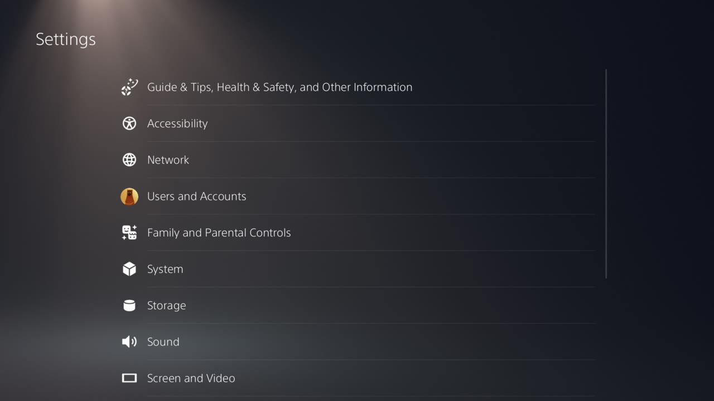

Depois em **Sistema → Software do sistema → Informações do console**:

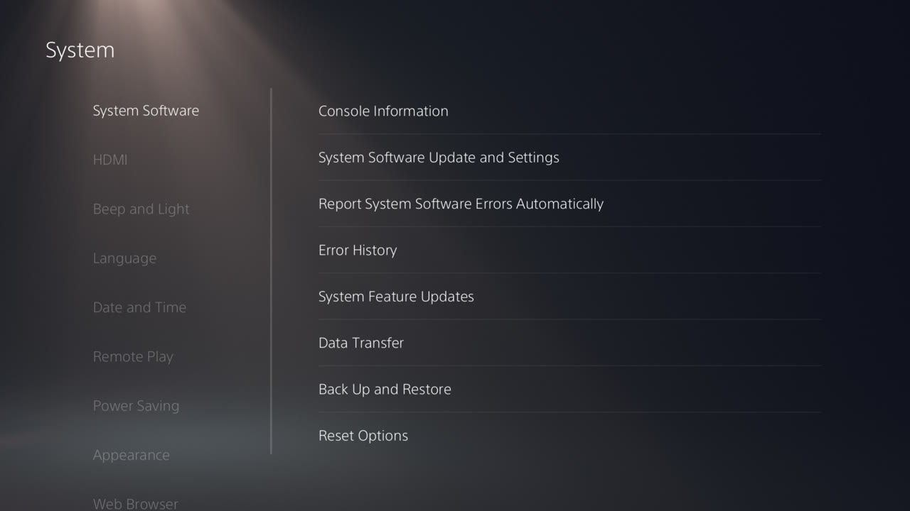

Agora compare com a tabela:

| Versão do sistema     | Situação                                                                                                     |
| --------------------- | ------------------------------------------------------------------------------------------------------------ |
| **13.60 ou inferior** | ✅ Dá para desbloquear. Siga para o [Passo 3](#passo-3-como-desbloquear).                                    |
| **14.00 – 14.10**     | ⏳ Ainda não tem nada, mas a comunidade está trabalhando nisso. **Não atualize** o console (veja o Passo 2). |
| **14.20 ou superior** | ❌ Não tem nada no momento.                                                                                  |

Se você está na versão 14.20 ou superior e quer muito fazer o desbloqueio, minha recomendação é vender o seu e comprar um console com uma versão antiga do sistema (aproveite a Black Friday).

## Passo 2: Desative as atualizações automáticas

Se o seu console está numa versão compatível (ou numa versão que pode ganhar desbloqueio no futuro), **não deixe ele atualizar sozinho**.

Vá em **Configurações → Sistema → Software do sistema → Atualização e configurações do software do sistema** e desative:

- **Baixar arquivos de atualização automaticamente**
- **Instalar arquivos de atualização automaticamente**

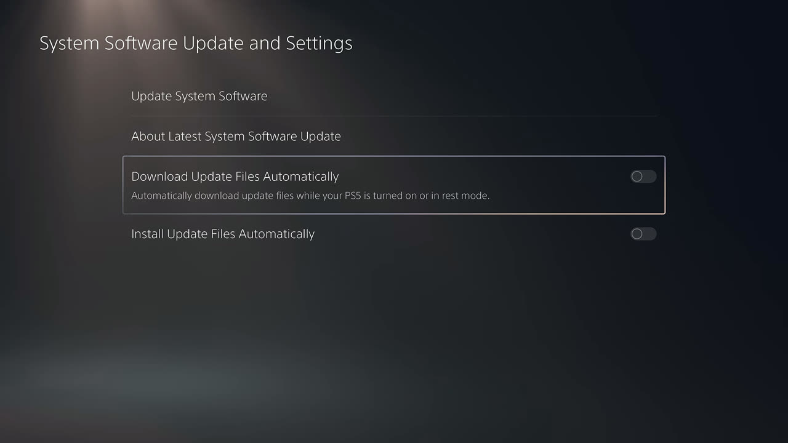

E quando o console pedir para atualizar, recuse.

## Passo 3: Como desbloquear

Recomendo seguir o vídeo do ModdedWarfare, que tem dublagem em PT-BR. Logo abaixo tem o mesmo passo a passo por escrito, com prints do vídeo.

<iframe width="560" height="315" src="https://www.youtube.com/embed/HqF1rmvA2iE" title="YouTube video player" frameborder="0" allow="accelerometer; autoplay; clipboard-write; encrypted-media; gyroscope; picture-in-picture; web-share" referrerpolicy="strict-origin-when-cross-origin" allowfullscreen></iframe>

!!! tip "Resumo rápido"

    1. Desconecte da internet, desative as atualizações e confira a versão (de **7.00 até 13.60**).
    2. Limpe os dados do navegador, coloque um **DNS manual** que bloqueia as atualizações e **anote o IP** do console.
    3. Abra o **Guia do usuário** e rode o jailbreak **Relapse**.
    4. Instale o **Payload Manager (pldmgr)** e, por ele, os payloads principais.
    5. Instale o **WebKit Autoloader** para fazer o jailbreak offline das próximas vezes.
    6. Instale apps e jogos pelo **PS5Upload** (pela rede) ou por um **pendrive**.

### 3.1 Prepare o console

1. Vá em **Configurações → Rede → Configurações** e desmarque **Conectar-se à internet** (só por enquanto).
2. Confira se as atualizações automáticas estão desativadas ([Passo 2](#passo-2-desative-as-atualizacoes-automaticas)).
3. Confira a versão do sistema ([Passo 1](#passo-1-confira-a-versao-do-seu-sistema)). Esse jailbreak funciona **da 7.00 até a 13.60**.
4. Vá em **Configurações → Sistema → Navegador da Web** e use **Excluir cookies** e **Limpar dados do site**.

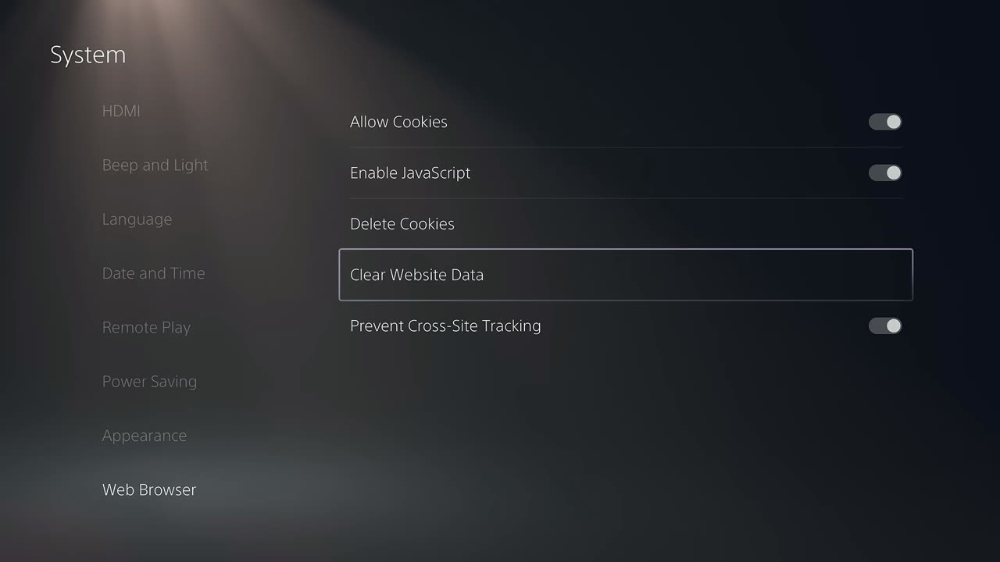

### 3.2 Configure o DNS

1. Volte em **Rede → Configurações**, ative a internet e configure a conexão (cabo ou Wi-Fi).
2. Na conexão, abra as **Configurações avançadas** (se já estiver conectado, aperte **Options** em cima da rede).
3. Em **Configurações de DNS**, troque de **Automático** para **Manual** e coloque como **DNS primário** um destes:
   - `62.210.38.117`
   - `45.56.67.85`

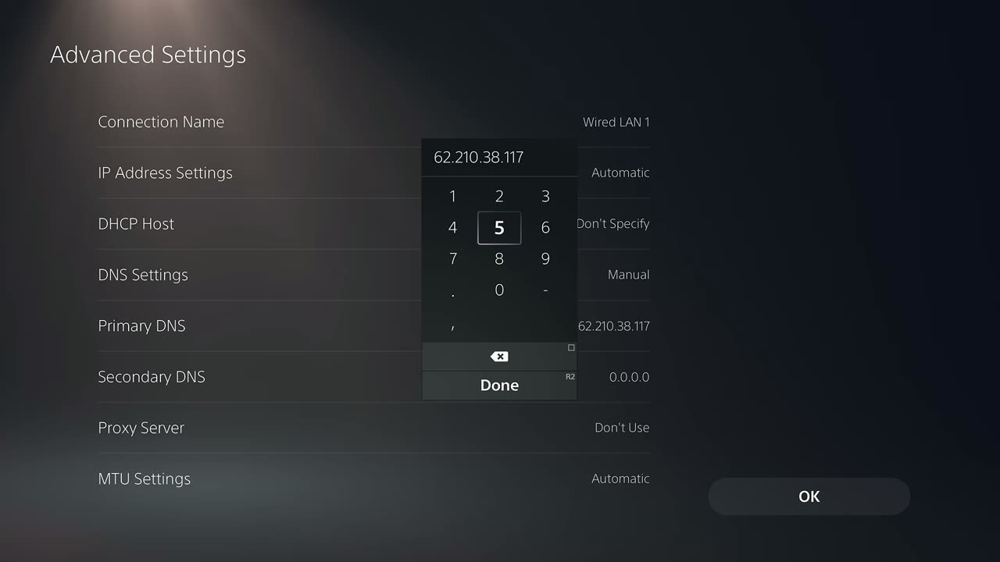

!!! note

    É normal o teste de conexão dizer que **não conseguiu conectar à internet**. Esses DNS bloqueiam os servidores de atualização da Sony, é isso que queremos. Páginas da Sony, como a da sua conta, também vão mostrar **Não é possível exibir a página**.

    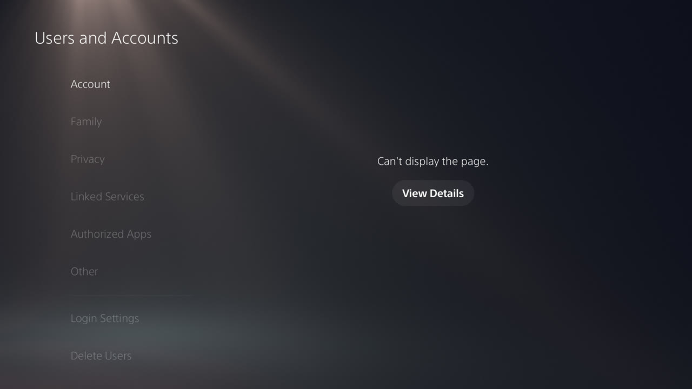

4. Vá em **Configurações → Sistema → Software do sistema → Informações do console** e **anote o endereço IPv4** do seu PS5 (ex.: `192.168.1.23`). Você vai precisar dele depois para acessar o Payload Manager pelo navegador e para conectar o PS5Upload.

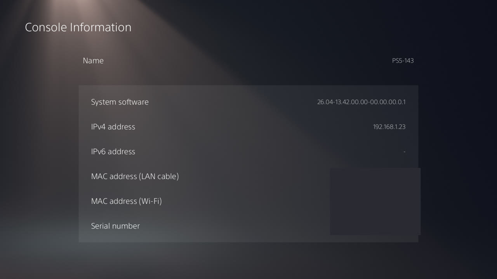

### 3.3 Rode o jailbreak

1. Vá em **Configurações → Guia e dicas → Guia do usuário** e aceite o certificado de segurança.
2. Vai abrir uma página com vários sites que hospedam o jailbreak. Se um não funcionar, é só tentar outro (ex.: Karo, ou o Relapse do Sonic).

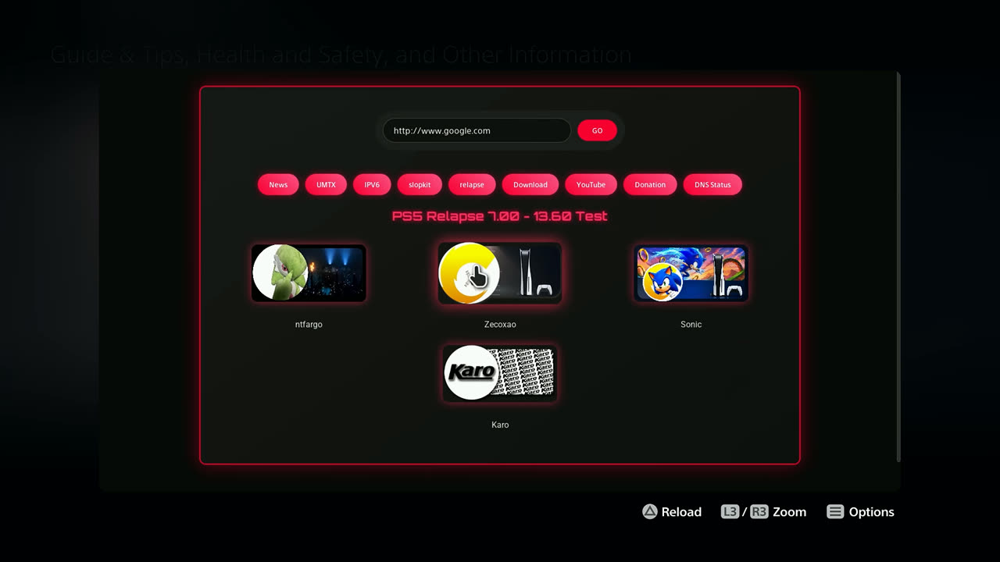

3. Na página do **Relapse**, aperte **X** em **Jailbreak**.

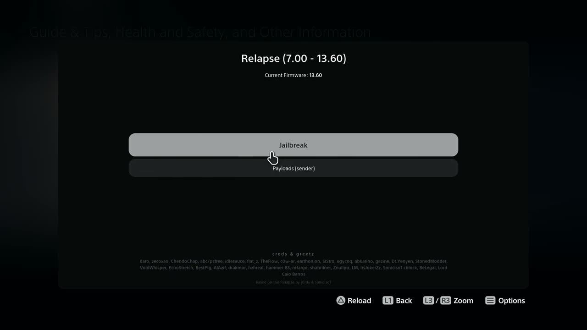

4. Se deu certo, aparece a página de **payloads**:

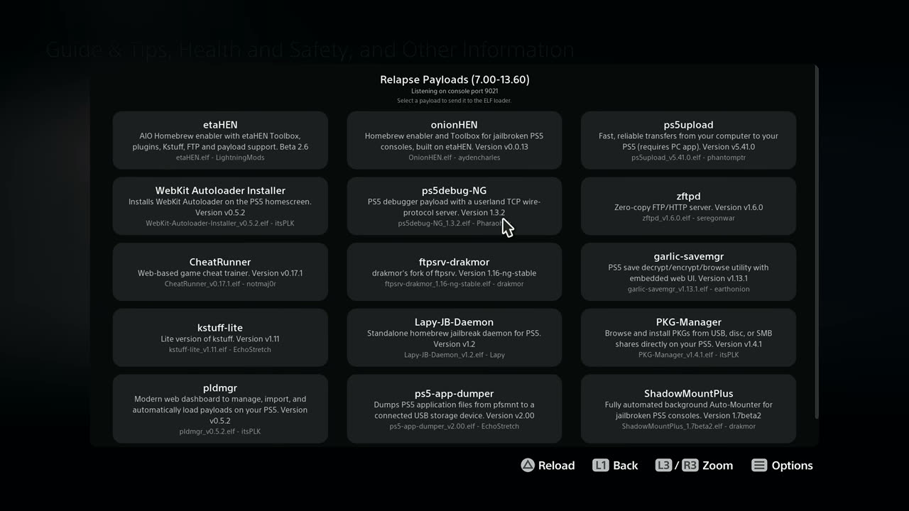

!!! warning "Não funcionou de primeira? Normal."

    O jailbreak não é 100% estável. Se travar ou o console desligar, **segure o botão de ligar até desligar**, ligue de novo (vai demorar mais para iniciar) e tente outra vez. Normalmente funciona em até 3 tentativas.

??? info "O Guia do usuário não abre a página do jailbreak?"

    Primeiro tente **sair e entrar de novo no seu perfil** do PS5 e abrir o Guia do usuário outra vez.

    Se ainda não funcionar, dá para usar o computador como servidor:

    1. Baixe o **PS4/PS5 Exploit Host** (link na descrição do vídeo) e abra no PC.
    2. Em **User's Guide**, selecione **relapse** e clique em **Start**. Se o firewall perguntar, permita o acesso.
    3. O programa mostra o IP do seu computador (ex.: `192.168.1.128`). Coloque **esse IP** como DNS primário no PS5.
    4. Abra o Guia do usuário de novo. Se não carregar, use as opções **Open firewall ports** ou **Turn firewall off** no programa.

    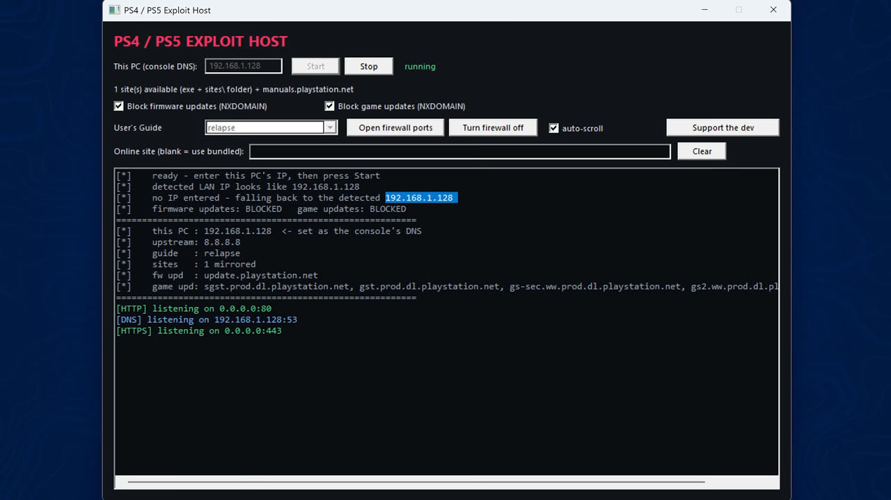

### 3.4 Instale o Payload Manager e os payloads

1. Na página de payloads, escolha o **pldmgr** (Payload Manager).
2. Se ele abrir com os ícones bugados, feche e abra pelo atalho que ele cria na aba **Mídia**. Se o atalho não aparecer, volte no Guia do usuário, escolha **Payloads only** e rode o pldmgr de novo.
3. Vá em **Manage Payloads → Cloud Repository** (aperte para atualizar se estiver vazio) e instale:
   - **Loaders** → WebKit Autoloader Installer
   - **Networking & Servers** → PS5Upload
   - **System & Jailbreak** → kstuff-lite
   - **Utilities & Tools** → ShadowMountPlus

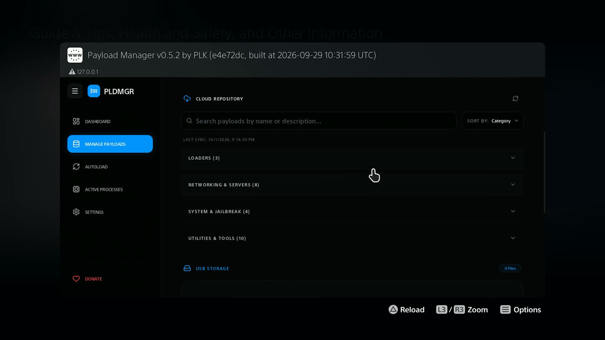

4. Em **Autoload**, ative o carregamento automático e adicione **kstuff-lite** e **ShadowMountPlus**. Os outros você roda manualmente quando precisar.

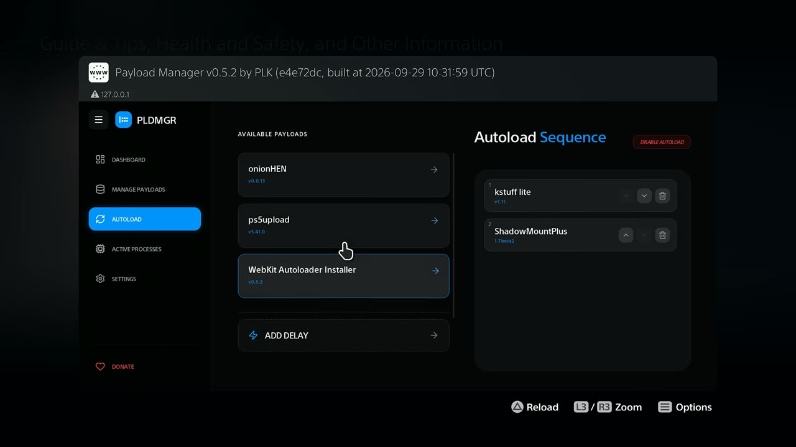

### 3.5 Jailbreak offline com o WebKit Autoloader

1. No **Dashboard** do pldmgr, rode o **WebKit Autoloader Installer**. Se aparecer um aviso de cache corrompido, escolha **Clear WebKit Data & Retry**.
2. Quando terminar, aparece o ícone **WebKit Autoloader** na aba **Mídia**.

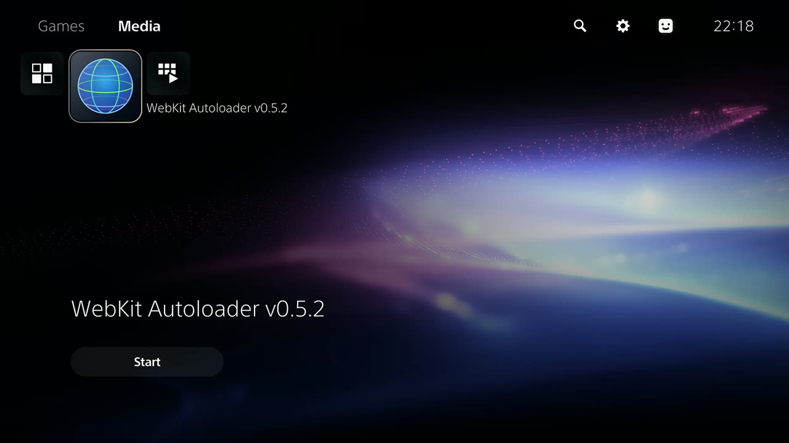

Agora você não depende mais dos sites públicos nem da internet: é só abrir o WebKit Autoloader que ele faz o jailbreak, abre o pldmgr e, depois de 5 segundos, carrega os seus payloads.

!!! info "O jailbreak não é permanente"

    Toda vez que você **reiniciar ou desligar** o PS5, precisa rodar o jailbreak de novo (pelo WebKit Autoloader). Se usar o **modo de repouso**, o jailbreak continua ativo.

??? tip "Extra: enviar payloads que não estão no repositório (ex.: etaHEN)"

    1. Pegue o IP do PS5 que você anotou no [passo 3.2](#32-configure-o-dns).
    2. No celular ou PC (na mesma rede), abra o navegador em `http://IP-DO-PS5:8084`.
    3. Em **Manage Payloads**, envie o arquivo `.elf`. Ele vai aparecer no pldmgr do console para você carregar.

    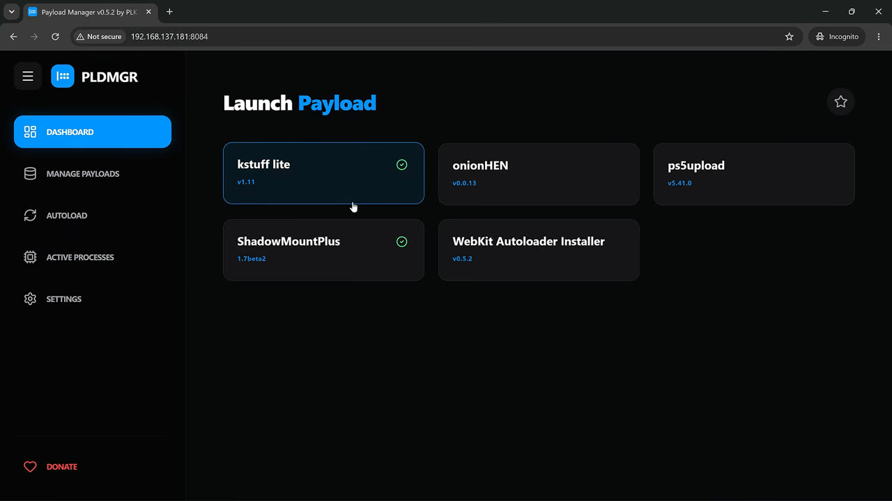

### 3.6 Instalando apps e jogos

Apps homebrew você encontra no [homebrew.page](https://homebrew.page/) ou na [Prospero Store](#prospero-store).

!!! warning "Formatos e versões"

    - Arquivos `.pkg` de **PS4** funcionam normalmente.
    - Arquivos `.pkg` de **PS5** só funcionam até a versão **11.60** (por enquanto).
    - Jogos de PS5 também podem vir como pasta extraída, `.exfat` ou `.ffpfs`. O ShadowMountPlus monta esses automaticamente.

#### Convertendo formatos: Alembic

[Alembic](https://prosperostore.net/app/PPSA99594/), converte pacotes e dumps de PS4 e PS5 entre FPKG, exFAT, FFPKG, FFPFS e FFPFSC, direto no console ou no PC. Útil para transformar seus dumps de PS4 em pacotes `.pkg` e vice-versa.

[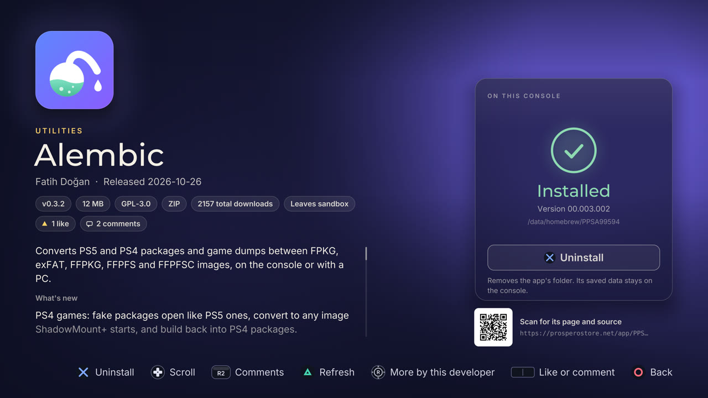](https://prosperostore.net/app/PPSA99594/)

#### Pela rede: PS5Upload

1. No PS5, rode o payload **PS5Upload** pelo pldmgr.
2. Baixe o [PS5Upload](https://github.com/phantomptr/ps5upload/releases) no PC ou celular (tem para Windows, macOS, Linux e Android).
3. Clique em **Connect PS5**, coloque o IP do PS5 (o que você anotou no [passo 3.2](#32-configure-o-dns)) e clique em **Check**. Se não conectar, use **Send helper**.

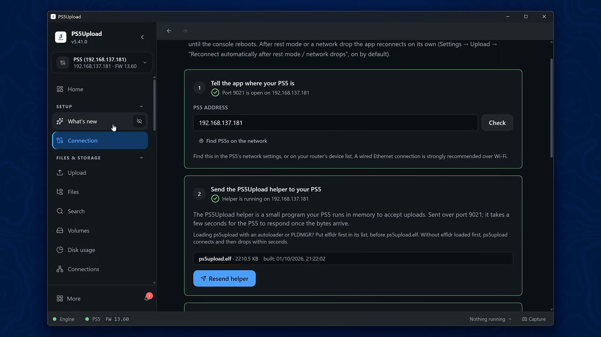

4. Em **Upload**, arraste os arquivos, deixe o destino em **homebrew** e clique em **Upload**. Ele instala tudo e coloca na tela inicial sozinho.

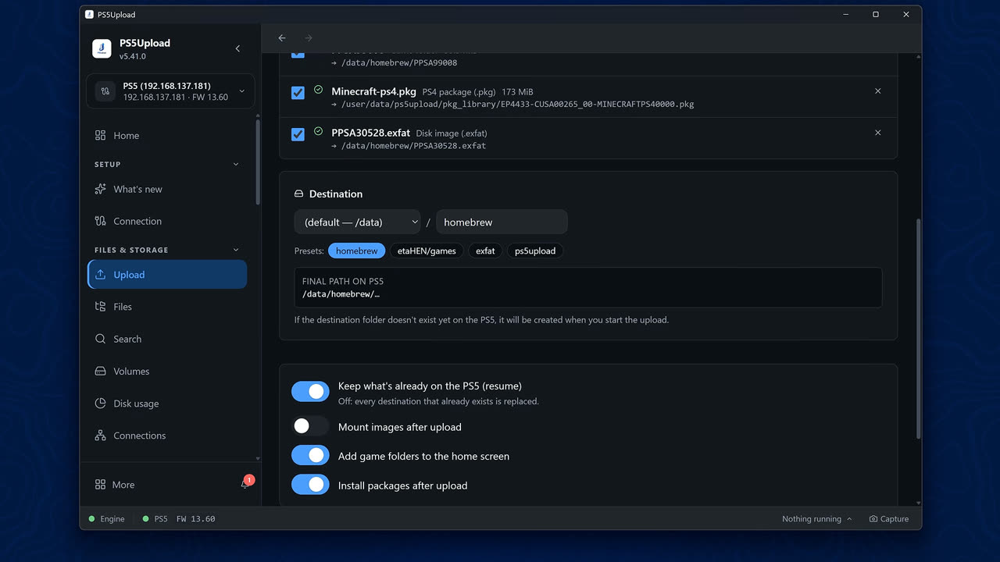

#### Pelo pendrive (mais rápido)

1. Formate o pendrive em **exFAT** ou **FAT32**.
2. Crie uma pasta `homebrew` na raiz e coloque os apps de PS5 dentro dela. Os `.pkg` de PS4 vão direto na raiz do pendrive.
3. No pldmgr, instale e rode o **ps5 web file manager** (em Utilities). Ele cria o ícone **Web File Manager** na aba Mídia.
4. Abra o Web File Manager, vá em `/mnt/usb0`, copie a pasta `homebrew` e cole dentro de `/data`.

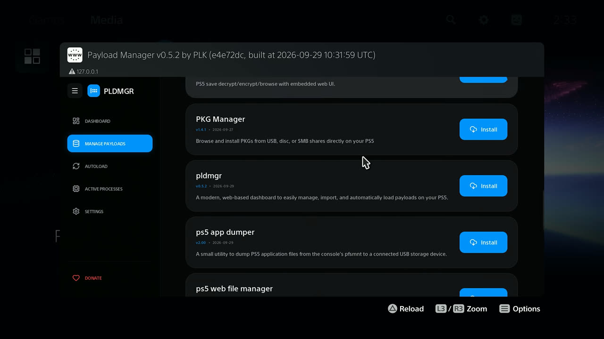

5. Para os `.pkg` de PS4: **Configurações → Configurações de depuração → Game → Package Installer** (com etaHEN: **Content Management → Package Installer**) e instale.

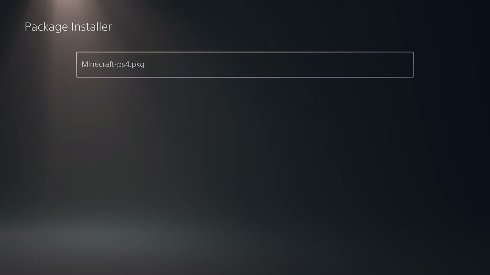

### Método alternativo: Y2JB

Também dá para desbloquear usando o Y2JB. Eu pessoalmente não usei, mas o processo é bem parecido e, supostamente, funciona melhor.

<iframe width="560" height="315" src="https://www.youtube.com/embed/VbxdlHFNbqc" title="YouTube video player" frameborder="0" allow="accelerometer; autoplay; clipboard-write; encrypted-media; gyroscope; picture-in-picture; web-share" referrerpolicy="strict-origin-when-cross-origin" allowfullscreen></iframe>

## Prospero Store

A [Prospero Store](https://prosperostore.net) é uma loja não oficial, feita pela comunidade, que reúne emuladores e apps homebrew. É o jeito mais fácil de instalar tudo o que aparece daqui pra baixo, e ela também atualiza os apps direto do PS5.

[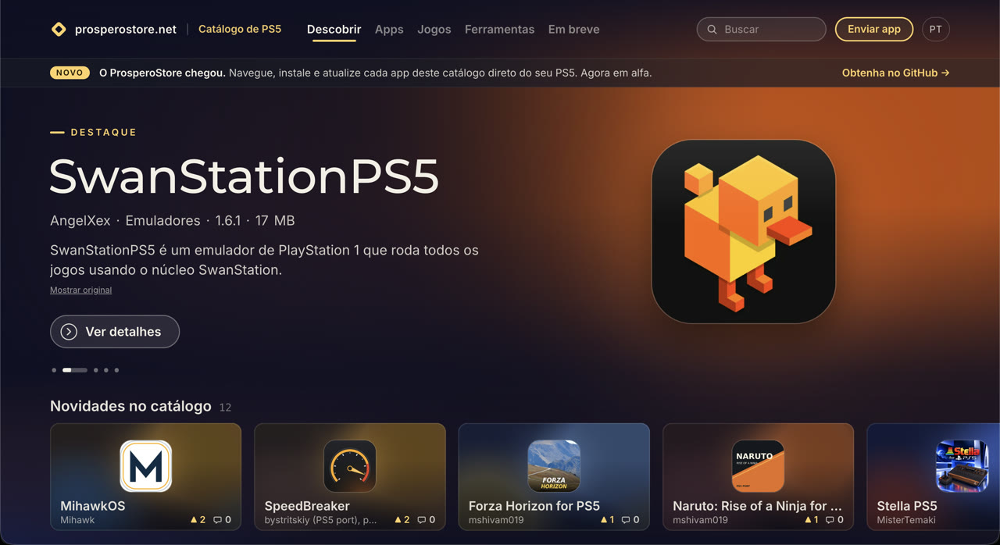](https://prosperostore.net)

**Como instalar:**

1. Baixe o `PPSA99000.zip` da [última versão no GitHub](https://github.com/darkxex/ProsperoStore/releases).
2. Extraia e envie a pasta para o PS5 pelo [PS5Upload ou pelo pendrive](#36-instalando-apps-e-jogos), igual a qualquer outro app.
3. Abra a Prospero Store pela tela inicial e instale os apps por ela.

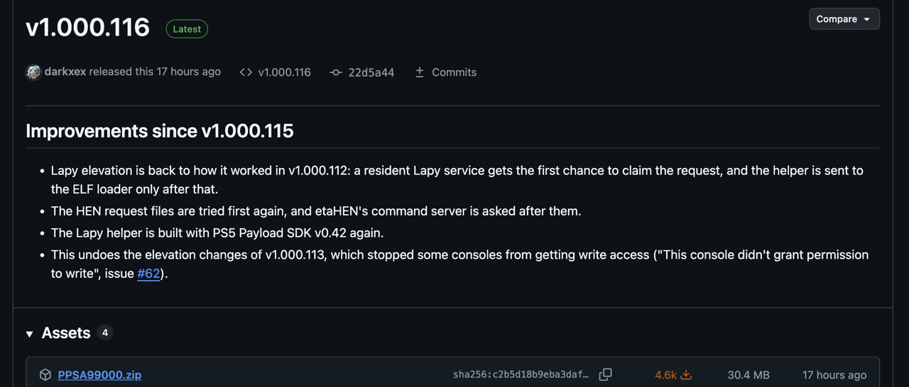

<iframe width="560" height="315" src="https://www.youtube.com/embed/rBVpEPNpkTk" title="YouTube video player" frameborder="0" allow="accelerometer; autoplay; clipboard-write; encrypted-media; gyroscope; picture-in-picture; web-share" referrerpolicy="strict-origin-when-cross-origin" allowfullscreen></iframe>

## Emuladores

!!! info "Lembrete"

    Emuladores são legais, mas **jogos (ROMs/ISOs) e BIOS não vêm junto**. Use apenas cópias dos seus próprios jogos e consoles.

### PlayStation

#### PlayStation 1

[SwanStationPS5](https://prosperostore.net/app/PPSA98510/), baseado no SwanStation.

[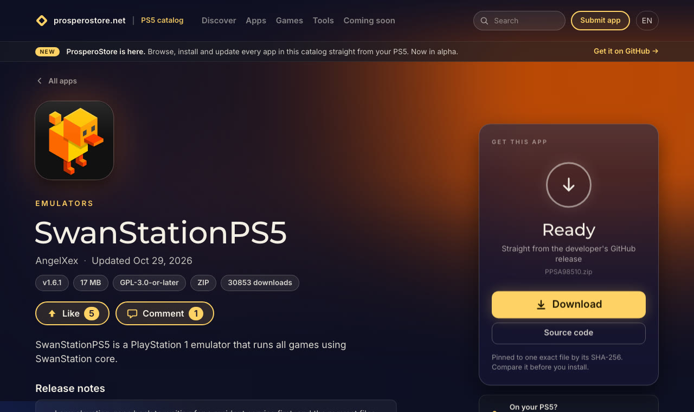](https://prosperostore.net/app/PPSA98510/)

#### PlayStation 2

[PS5SX2](https://prosperostore.net/app/PPSA99203/), baseado no PCSX2. Se preferir, também tem no [GitHub](https://github.com/Swordpdf/PS5SX2/releases).

[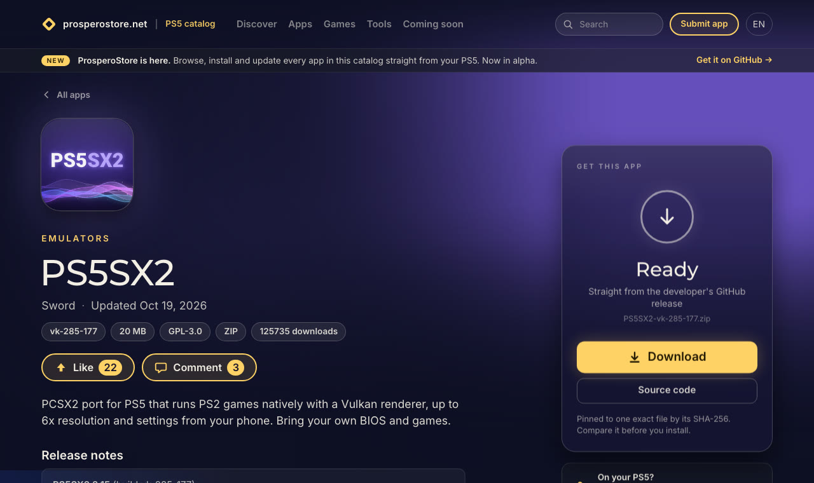](https://prosperostore.net/app/PPSA99203/)

Ele também consegue rodar jogos direto do **seu disco** no leitor do PS5:

<blockquote class="twitter-tweet" data-media-max-width="560">
PS2 discs. Straight into a PS5. 20+ years of nostalgia, one disc away. PS5SX2 🎮  special thanks to <a href="https://x.com/_AlAzif?ref_src=twsrc%5Etfw">@_AlAzif</a>   🔗 <a href="https://t.co/5dJBpctESW">https://t.co/5dJBpctESW</a> 💬 <a href="https://t.co/0NNel5pqQt">https://t.co/0NNel5pqQt</a> ☕ <a href="https://t.co/EypS5hoENk">https://t.co/EypS5hoENk</a><a href="https://x.com/hashtag/PS5?src=hash&amp;ref_src=twsrc%5Etfw">#PS5</a> <a href="https://x.com/hashtag/PS2?src=hash&amp;ref_src=twsrc%5Etfw">#PS2</a> <a href="https://x.com/hashtag/PlayStation?src=hash&amp;ref_src=twsrc%5Etfw">#PlayStation</a> <a href="https://x.com/hashtag/PS5SX2?src=hash&amp;ref_src=twsrc%5Etfw">#PS5SX2</a> <a href="https://x.com/hashtag/Homebrew?src=hash&amp;ref_src=twsrc%5Etfw">#Homebrew</a> <a href="https://x.com/hashtag/Emulation?src=hash&amp;ref_src=twsrc%5Etfw">#Emulation</a> <a href="https://t.co/mMcp41vFOX">pic.twitter.com/mMcp41vFOX</a>
&mdash; Sword (@sword_pdf) <a href="https://x.com/sword_pdf/status/2108655657616585178?ref_src=twsrc%5Etfw">October 9, 2026</a></blockquote> 

#### PlayStation 3

O PS5SX3 ainda não está na Prospero Store. Entre no [Discord do desenvolvedor](https://discord.gg/wEU6UNueWc), baixe o `PS5SX3-Installer.elf` e envie pelo Payload Manager (veja [como enviar um `.elf`](#35-jailbreak-offline-com-o-webkit-autoloader)).

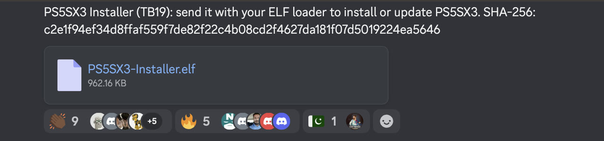

E o melhor: ele também roda jogos direto do disco:

<blockquote class="twitter-tweet" data-media-max-width="560">
First PS2 discs. Now PS3 discs. The PS5 is slowly becoming the PlayStation it should&#39;ve been. 🎮  Sony gave us five generations of PlayStation, We&#39;re trying to fit them all into one.<a href="https://x.com/hashtag/PS5?src=hash&amp;ref_src=twsrc%5Etfw">#PS5</a> <a href="https://x.com/hashtag/PS3?src=hash&amp;ref_src=twsrc%5Etfw">#PS3</a> <a href="https://x.com/hashtag/PlayStation?src=hash&amp;ref_src=twsrc%5Etfw">#PlayStation</a> <a href="https://x.com/hashtag/PS5SX2?src=hash&amp;ref_src=twsrc%5Etfw">#PS5SX2</a> <a href="https://x.com/hashtag/PS5SX3?src=hash&amp;ref_src=twsrc%5Etfw">#PS5SX3</a> <a href="https://x.com/hashtag/RPCS3?src=hash&amp;ref_src=twsrc%5Etfw">#RPCS3</a> <a href="https://x.com/hashtag/PS5Pro?src=hash&amp;ref_src=twsrc%5Etfw">#PS5Pro</a> <a href="https://x.com/hashtag/Emulation?src=hash&amp;ref_src=twsrc%5Etfw">#Emulation</a> <a href="https://x.com/hashtag/BackwardsCompatibility?src=hash&amp;ref_src=twsrc%5Etfw">#BackwardsCompatibility</a>… <a href="https://t.co/O8Bfp3JXWk">pic.twitter.com/O8Bfp3JXWk</a>
&mdash; Sword (@sword_pdf) <a href="https://x.com/sword_pdf/status/2109429474521465335?ref_src=twsrc%5Etfw">October 11, 2026</a></blockquote> 

#### PSP

[PSP5](https://prosperostore.net/app/PPSA99131/), baseado no PPSSPP.

[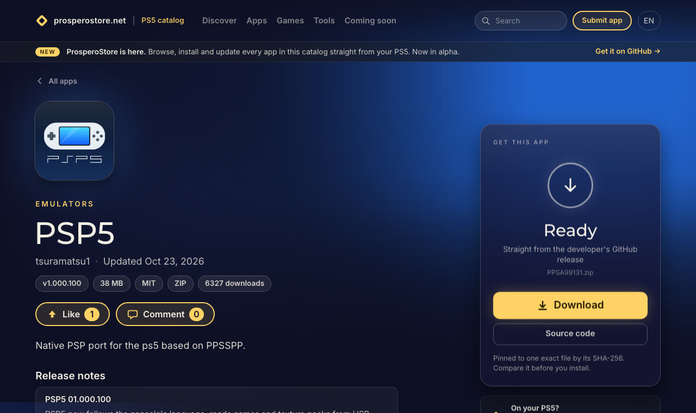](https://prosperostore.net/app/PPSA99131/)

!!! note "Em breve"

    Ainda estou escrevendo esta parte.

### Nintendo

#### NES, SNES, Game Boy, GBA, 64

[RetroArch](https://prosperostore.net/app/PPSA99169/), com cores de NES, SNES, GBA, Genesis, arcade e mais.

Ainda não usei no PlayStation (difícil querer jogar Game Boy quando tem emulador de PS3 kkkk), só no PC. Depois coloco um guia de como configurar.

[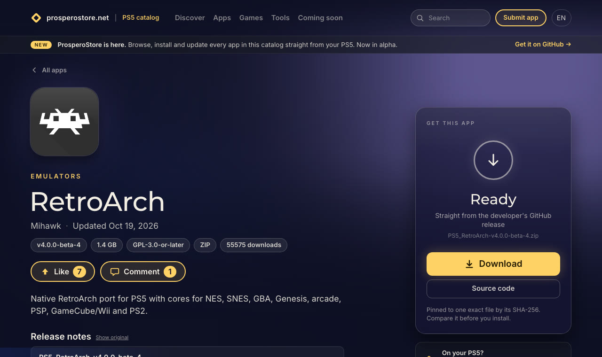](https://prosperostore.net/app/PPSA99169/)

#### Wii e GameCube

[Porpoise](https://prosperostore.net/app/PPSA99764/), baseado no Dolphin. Tem biblioteca com capas, memory cards e tudo mais.

[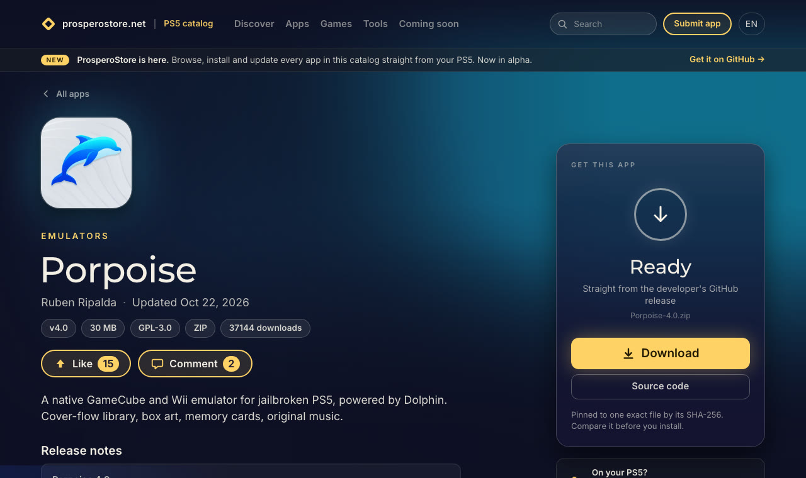](https://prosperostore.net/app/PPSA99764/)

#### Nintendo DS, 3DS, Wii U e Nintendo Switch

[PS5-ECAM](https://prosperostore.net/app/PPSA99360/), um launcher só para os quatro consoles:

- **Wii U**: Cemu
- **3DS**: Azahar
- **DS**: melonDS
- **Switch**: Eden

[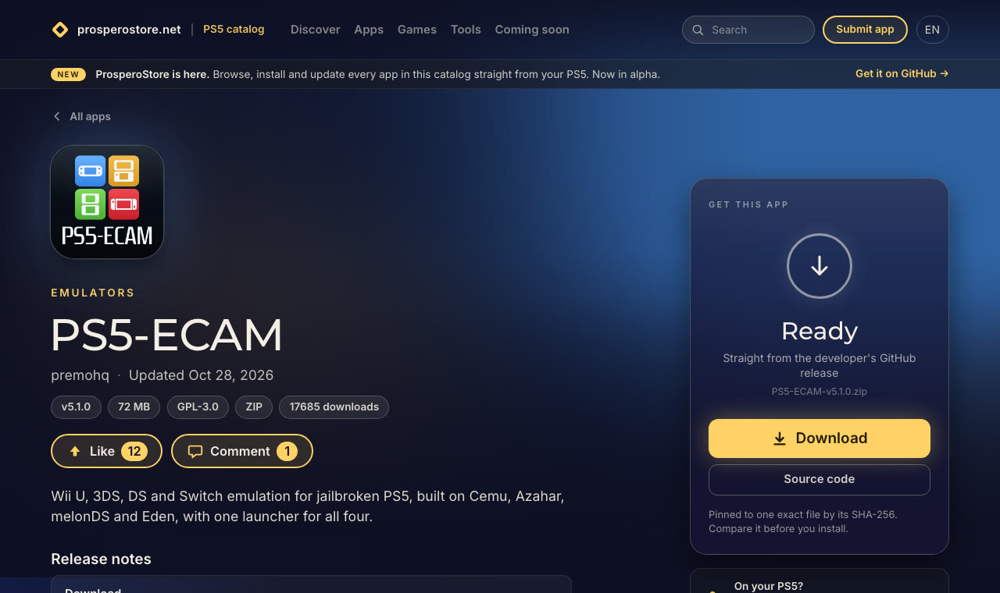](https://prosperostore.net/app/PPSA99360/)

### Xbox

#### Xbox original

[XPSemu](https://prosperostore.net/app/PPSA97358/), baseado no Xemu.

[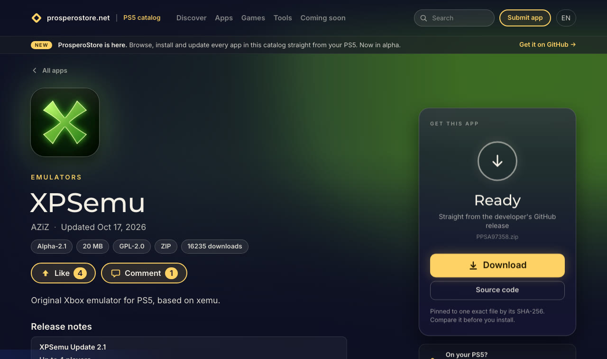](https://prosperostore.net/app/PPSA97358/)

#### Xbox 360

[PS5X360](https://prosperostore.net/app/PPSA50011/), baseado no Xenia Canary (ainda experimental).

[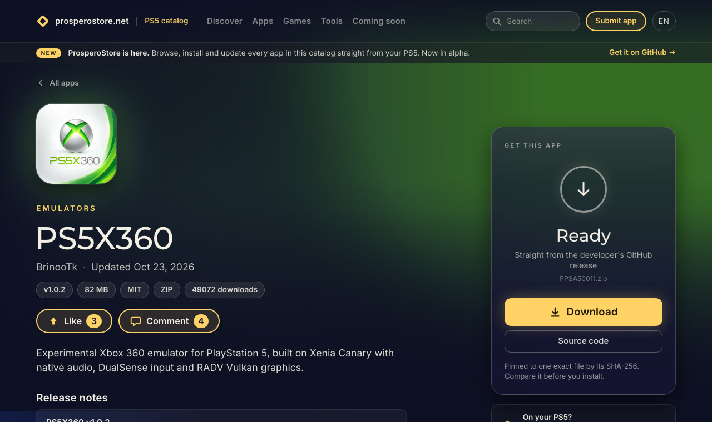](https://prosperostore.net/app/PPSA50011/)

#### Xbox One

Não tem emulador, mas poucos jogos são exclusivos de verdade: a maioria já tem uma versão ou alternativa no PS4, PS5 ou PC. Veja a [lista de exclusivos do Xbox One](https://en.wikipedia.org/wiki/Category:Xbox_One-only_games).

## Minecraft: ProsperoCraft

[ProsperoCraft](https://prosperostore.net/app/PPSA99874/), Minecraft Java rodando nativo no PS5.

Atualmente tem suporte à versão 26.3 e ao Modrinth, porém alguns mods não funcionam. [Veja aqui a lista](https://github.com/mateo-cogeanu/ProsperoCraft/issues/8). Use a sua conta original do Minecraft.

[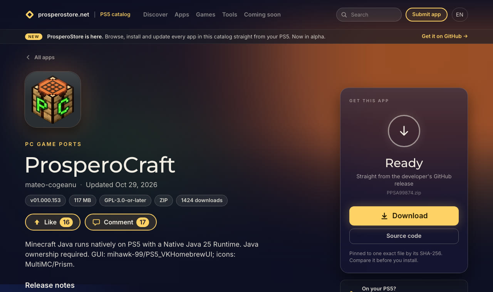](https://prosperostore.net/app/PPSA99874/)

## Steam

Tem dois jeitos de rodar seus jogos da Steam. Ambos pegam o jogo e rodam dentro de uma camada de compatibilidade.

Nem todos os jogos funcionam: jogos com launcher próprio ou com anti-cheat provavelmente não vão rodar. Os aplicativos também têm configurações por jogo, então não esqueça de experimentar para deixar tudo rodando liso.

Mesmo assim, Cyberpunk 2077 roda perfeitamente, e com o PlayDen dá para jogar online em jogos como Terraria.

### MihawkOS

[MihawkOS](https://prosperostore.net/app/PPSA99170/), um sistema inspirado no Windows que roda jogos de PC via Wine/Proton.

Veja a [lista de compatibilidade do MihawkOS](https://mihawk-99.github.io/MihawkOS-Compatibility/).

[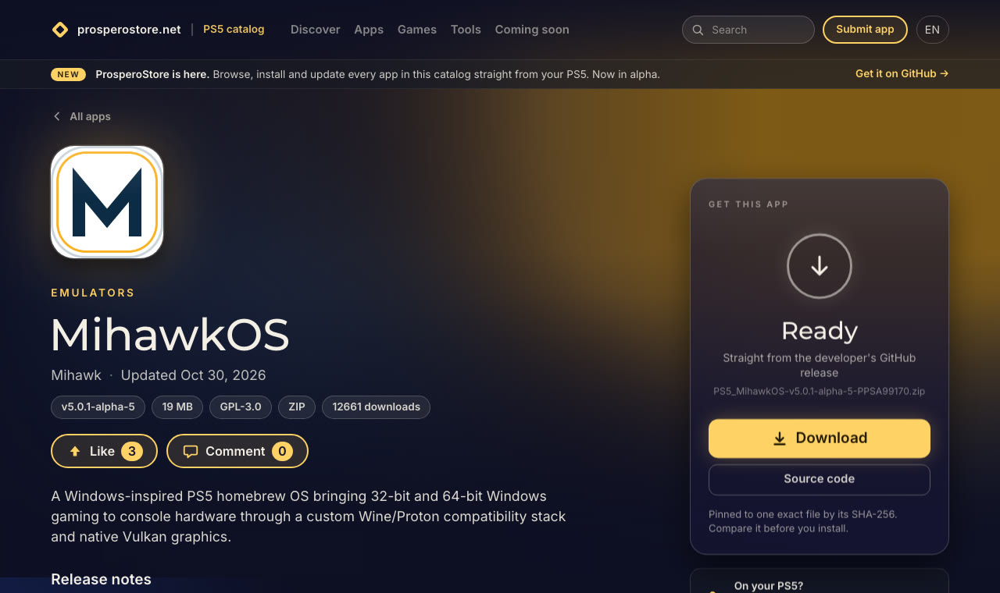](https://prosperostore.net/app/PPSA99170/)

### PlayDen

[PlayDen](https://prosperostore.net/app/FAKE77031/), entra na sua conta Steam, baixa e roda seus jogos de Windows via Wine.

[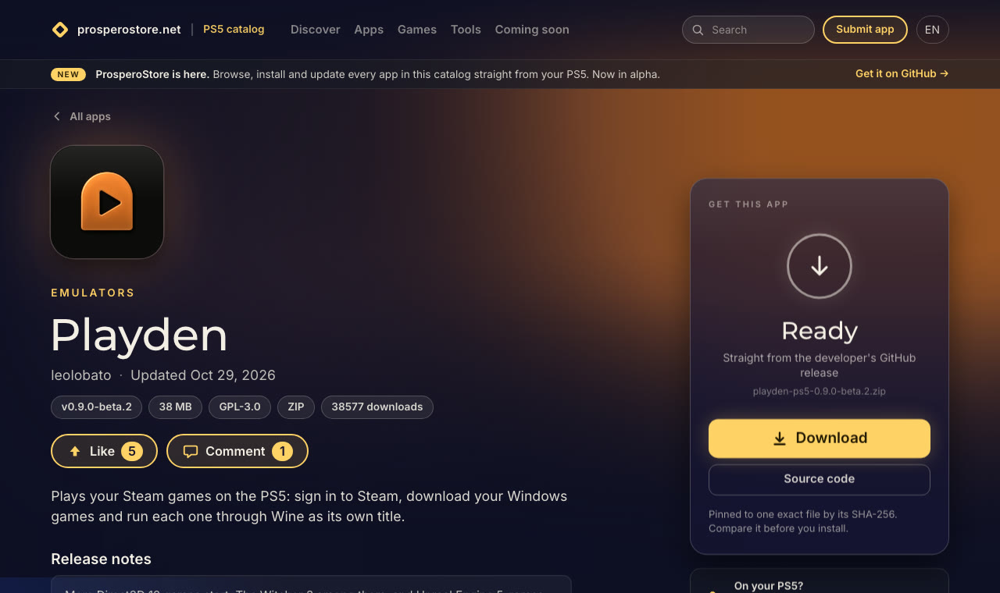](https://prosperostore.net/app/FAKE77031/)

<iframe width="560" height="315" src="https://www.youtube.com/embed/VQk7A8glqAc?start=8" title="YouTube video player" frameborder="0" allow="accelerometer; autoplay; clipboard-write; encrypted-media; gyroscope; picture-in-picture; web-share" referrerpolicy="strict-origin-when-cross-origin" allowfullscreen></iframe>

## Linux

Ainda não instalei o Linux, porque preciso limpar meu SSD primeiro, então não posso falar por experiência própria como funciona. Assim que eu fizer, eu atualizo aqui.

<iframe width="560" height="315" src="https://www.youtube.com/embed/FNRfA2Q6zkU" title="YouTube video player" frameborder="0" allow="accelerometer; autoplay; clipboard-write; encrypted-media; gyroscope; picture-in-picture; web-share" referrerpolicy="strict-origin-when-cross-origin" allowfullscreen></iframe>
